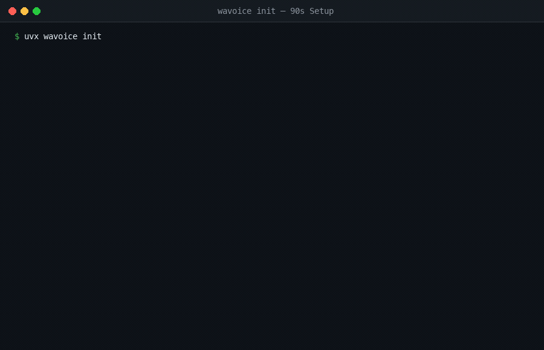

# WAVoice 📞

**Let people call your AI voice assistant on WhatsApp.**

Connect your WhatsApp Business number to **Retell AI**, **LiveKit**, **Gemini**, or **Dograh** in under two minutes. No webhook configuration, no media servers, and no headaches with Meta's developer dashboard.

[](https://www.python.org/)
[](https://opensource.org/licenses/MIT)
[](https://doi.org/10.5281/zenodo.23537489)
[](https://github.com/amitbhakt)

<p align="center">
  
</p>

---

## What is this?

If you built an AI voice agent on **Retell**, **LiveKit**, or **Dograh**, you probably want people to be able to call it. 

Meta allows voice calling on WhatsApp Business numbers, but getting it connected to your agent is painful: you have to set up WebRTC servers, create public tunnels, register webhooks across multiple menus, and deal with dropped calls.

**WAVoice does all of that for you with one command.** It connects your WhatsApp number straight to your voice agent so you can test live calls on your phone right away.

---

## Pick your platform

Choose the tool you are using and run the command in your terminal:

| Platform | Command | What it does |
| :--- | :--- | :--- |
| **Retell AI** | `uvx wavoice retell start` | Connects your WhatsApp number to your Retell agent |
| **LiveKit** | `uvx wavoice livekit dev` | Routes WhatsApp calls into a LiveKit voice room |
| **Gemini (Built-in)** | `uvx wavoice init` | Answers calls with Google Gemini 2.0 Flash (no extra setup) |
| **Dograh (No-code)** | `uvx wavoice dograh setup` | Connects your WhatsApp number to your Dograh visual agent |

*(Don't have `uv`? You can also run `pip install wavoice` and use `wavoice` directly).*

---

## 3-step quickstart

### 1. Have these 3 things ready from Meta
Head over to [developers.facebook.com](https://developers.facebook.com) and make sure you have:
1. A **Meta Developer App** with the WhatsApp product added.
2. A **System User Access Token** (with `whatsapp_business_messaging` and `whatsapp_business_management` permissions).
3. A **WhatsApp Business Phone Number** (the free test number Meta gives you works fine).

### 2. Run the command
Pick your platform above and run it. The setup will ask for your Meta token and your platform's API key. 

WAVoice automatically:
- Finds your WhatsApp phone number and account ID.
- Turns on WhatsApp Voice Calling for your number.
- Creates a secure connection tunnel so Meta can reach your computer.
- Sets up all required webhooks on Meta.

### 3. Call your number
Open WhatsApp on your phone, call your WhatsApp Business number, and speak directly to your AI agent!

---

## Trouble? Run `wavoice doctor`

If a call is just ringing or nobody answers:

```bash
uvx wavoice doctor
```

This runs a quick health check on your setup and tells you exactly what is wrong (like an expired Meta token or a missing permission).

---

<details>
<summary>🔧 <b>How it works under the hood (Technical Architecture)</b></summary>

<br>

WhatsApp calls do not work like standard phone calls or basic HTTP webhooks:
- When someone calls your number, Meta sends a WebRTC session request (SDP offer) over HTTPS.
- Audio is streamed back and forth via encrypted SRTP packets over UDP.
- Meta often sends duplicate webhooks at the same time, which can trigger multiple bot instances for the same call.

```
WhatsApp Caller (Mobile App)
             │
             ▼ WebRTC (SDP offer / SRTP audio)
    Meta Graph API Webhook
             │
             ▼ Public Tunnel / Ingress
          WAVoice
   ┌─────────┴─────────────────────────────────────────┐
   │ • Decodes WebRTC audio stream                     │
   │ • Prevents duplicate call triggers                │
   │ • Negotiates codecs & manages call state          │
   └─────────┬─────────────────────────────────────────┘
             │
             ▼
  Your AI Platform (Retell / LiveKit / Gemini / Custom Python)
```

**What WAVoice automates:**
1. **Auto-Discovery**: Pulls your WABA ID and Phone Number ID directly from your token via the Graph API.
2. **Calling Activation**: Automatically sets `calling.status = "ENABLED"` on your phone number so the Call button appears in WhatsApp.
3. **3-Tier Webhook Sync**: Registers Phone overrides, WABA subscriptions, and App subscriptions to ensure calls never get dropped.
4. **WebRTC Media Plumbing**: Handles STUN/TURN traversal, SRTP decryption, and connects audio streams to your chosen provider.
5. **Call Claim Locks**: Uses atomic in-memory claiming per `call_id` so calls are answered exactly once.

</details>

<details>
<summary>🐍 <b>Custom Python Pipelines (Pipecat / Deepgram / OpenAI / Cartesia)</b></summary>

<br>

If you are a Python developer building a custom pipeline with your own Speech-to-Text, LLM, and Text-to-Speech models, you can use `WAVoice` with [Pipecat](https://github.com/pipecat-ai/pipecat):

```python
import os
from wavoice import WhatsAppVoiceApp
from pipecat.audio.vad.silero import SileroVADAnalyzer
from pipecat.pipeline.pipeline import Pipeline
from pipecat.pipeline.runner import PipelineRunner
from pipecat.pipeline.task import PipelineParams, PipelineTask
from pipecat.processors.aggregators.llm_context import LLMContext
from pipecat.processors.aggregators.llm_response_universal import (
    LLMContextAggregatorPair,
    LLMUserAggregatorParams,
)
from pipecat.services.deepgram import DeepgramSTTService
from pipecat.services.openai import OpenAILLMService
from pipecat.services.cartesia import CartesiaTTSService

app = WhatsAppVoiceApp()

@app.on_call
async def handle_incoming_call(transport, call_info):
    caller = getattr(call_info, "from_", "caller")
    print(f"Incoming call from {caller}")

    # Set up your models
    stt = DeepgramSTTService(api_key=os.environ["DEEPGRAM_API_KEY"])
    llm = OpenAILLMService(api_key=os.environ["OPENAI_API_KEY"], model="gpt-4o-mini")
    tts = CartesiaTTSService(api_key=os.environ["CARTESIA_API_KEY"], voice_id="...")

    # Set up conversation context
    context = LLMContext([{"role": "system", "content": "You are a concise voice assistant."}])
    user_agg, assistant_agg = LLMContextAggregatorPair(
        context,
        user_params=LLMUserAggregatorParams(vad_analyzer=SileroVADAnalyzer()),
    )

    # Wire the audio from WhatsApp into your pipeline
    pipeline = Pipeline([
        transport.input(),    # WebRTC Audio In from WhatsApp
        stt,                  # Speech-to-Text
        user_agg,             # Turn Aggregator
        llm,                  # Large Language Model
        tts,                  # Text-to-Speech
        transport.output(),   # WebRTC Audio Out to WhatsApp
        assistant_agg,
    ])

    task = PipelineTask(pipeline=pipeline, params=PipelineParams(allow_interruptions=True))
    runner = PipelineRunner()
    await runner.run(task)

if __name__ == "__main__":
    app.run()
```

*(See [examples/custom_stt_llm_tts.py](examples/custom_stt_llm_tts.py) for the complete file).*

</details>

<details>
<summary>🚀 <b>Production Deployment & Permanent Domains</b></summary>

<br>

- **Local testing**: By default, WAVoice uses a temporary Cloudflare tunnel (`trycloudflare.com`). This is meant for quick local testing and development.
- **Production (24/7)**: For live production traffic, host WAVoice on your server with a permanent domain (or behind Nginx / Caddy / Cloudflare) and pass your URL:
  ```bash
  wavoice start --public-url https://voice.yourdomain.com
  # or
  wavoice livekit dev --public-url https://voice.yourdomain.com
  ```
- **Dograh Cloud**: If you use `wavoice dograh setup`, calls route directly to Dograh's cloud infrastructure—no local process or tunnel is needed.

</details>

<details>
<summary>📋 <b>CLI Command Reference</b></summary>

<br>

| Command | What it does |
| :--- | :--- |
| `wavoice init` | Complete setup wizard: prompts for credentials, turns on calling, and starts the Gemini voice agent. |
| `wavoice start` | Starts the local server and begins taking calls with the built-in Gemini agent. |
| `wavoice doctor` | Checks your Meta credentials, calling status, and webhook health. |
| `wavoice retell start` | Connects incoming WhatsApp calls directly to your Retell AI agent. |
| `wavoice retell doctor` | Checks your Retell API key and agent connection health. |
| `wavoice livekit setup` | Connects your WhatsApp number to LiveKit Cloud. |
| `wavoice livekit dev` | Runs the LiveKit webhook bridge and starts testing calls. |
| `wavoice livekit doctor` | Checks your LiveKit Cloud credentials and connection. |
| `wavoice dograh setup` | Connects WhatsApp directly to Dograh visual studio in the cloud. |
| `wavoice dograh doctor` | Checks your Dograh API key and telephony sync. |

</details>

<details>
<summary>🔒 <b>Privacy & Telemetry</b></summary>

<br>

WAVoice collects anonymous usage statistics (command runs, answered call count, coarse country/timezone) to help improve the project. It **never** collects personal information, phone numbers, tokens, or audio data.

To disable telemetry, you can:
- Add `--no-telemetry` to any command (e.g., `wavoice start --no-telemetry`)
- Set `WAVOICE_TELEMETRY=false` in your `.env` file
- Set `DO_NOT_TRACK=1` in your system environment

</details>

---

## Documentation by platform

- [Retell AI Guide](docs/retell.md)
- [LiveKit Cloud Guide](docs/livekit.md)
- [Dograh Cloud Guide](docs/dograh.md)
- [Pipecat / Custom Python Guide](docs/pipecat.md)

---

## Maintainer & License

Created by **Amit Bhakt** ([@amitbhakt](https://github.com/amitbhakt)).  
Released under the [MIT License](LICENSE). Contributions and issues are welcome on [GitHub](https://github.com/amitbhakt/wavoice).
